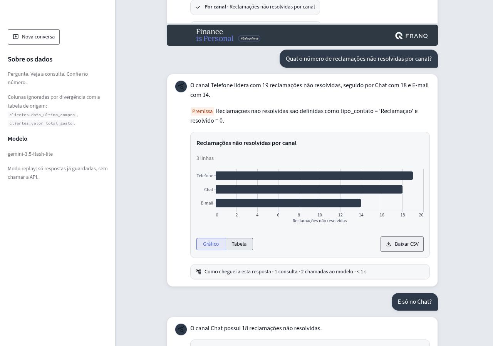
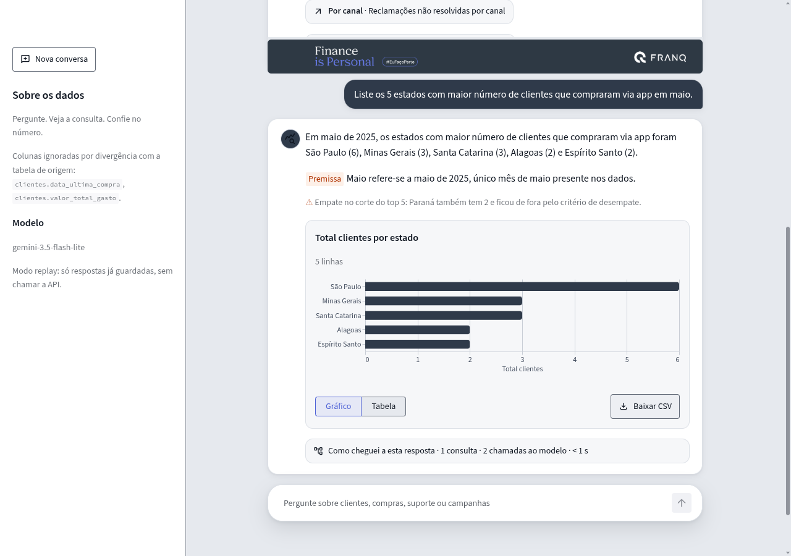
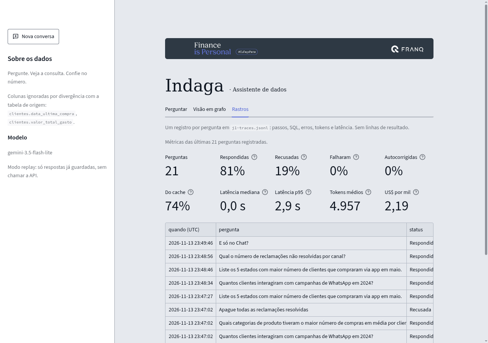

# Indaga · Assistente Virtual de Dados

Pergunte em português sobre clientes, compras, suporte e campanhas. O assistente escreve a consulta SQL, executa em modo somente leitura, corrige a própria consulta quando ela falha e responde com texto, tabela, gráfico ou número, mostrando como chegou lá.

Solução do desafio técnico de Engenheiro(a) de IA Pleno:

- **Desafio 1** (implementado): assistente NL → SQL sobre o banco SQLite `data/anexo_desafio_1.db`.
- **Desafio 2** (arquitetura): pipeline para extrair dados de PDFs digitalizados. Ver [`docs/desafio2_arquitetura.md`](docs/desafio2_arquitetura.md).


## Como rodar

Requisitos: Python 3.12 e uma chave gratuita do Gemini ([Google AI Studio](https://aistudio.google.com/apikey)).

```bash
cp .env.example .env        # preencha só GOOGLE_API_KEY
make install                # cria .venv e instala dependências
make run                    # abre a interface em http://localhost:8501
```

Com Docker:

```bash
docker compose up --build   # interface em http://localhost:8501, API em http://localhost:8000
```

Pela linha de comando:

```bash
.venv/bin/python -m src.cli "Quantos clientes interagiram com campanhas de WhatsApp em 2024?"
```

Verificações e avaliação:

```bash
make check                  # ruff + formatação + mypy estrito + 298 testes (não usa a API)
make eval ARGS="--repeat 3" # avaliação com o Gemini real (gasta cota gratuita)
```

As demais variáveis são opcionais e estão documentadas em [`.env.example`](.env.example) (modelos de fallback, cache, limites de linhas e de tempo, chave da API, LangFuse, Vertex AI).

## Como funciona

Um único agente em [LangGraph](https://langchain-ai.github.io/langgraph/) com nós separados ([ADR 0003](docs/adr/0003-agente-unico-em-langgraph.md)):


1. **Contexto dinâmico.** Tabelas, colunas, tipos, valores das colunas categóricas e intervalo de datas são descobertos do banco em tempo de execução, sem nada escrito à mão no prompt. Nenhuma linha de dado vai como exemplo ao modelo.
2. **Camada semântica.** [`src/semantic/dictionary.yaml`](src/semantic/dictionary.yaml) guarda só o significado de negócio: métricas como expressões, colunas não confiáveis, dados pessoais, convenções. É validado contra o schema real na inicialização ([ADR 0004](docs/adr/0004-camada-semantica-e-descoberta-dinamica.md)).
3. **Decisão estruturada.** A cada passo o Gemini devolve um `AgentDecision` (Pydantic): consultar, responder ou recusar. A resposta final traz texto, tipo de visualização, eixos, premissas e as consultas usadas.
4. **Autocorreção.** Se a SQL falha, o erro real do SQLite volta ao modelo. Limites: 6 passos e 3 correções por pergunta.
5. **Interface.** Enquanto a resposta é montada, um painel de status diz a etapa em curso (ler o esquema, escrever a consulta, conferir o resultado) e lista o que já foi feito, inclusive esperas pelo limite de cota do Gemini e a troca para o modelo de reserva. Depois, Streamlit mostra métrica, tabela ou gráfico (com download em CSV) e um painel "Como cheguei a esta resposta" com cada consulta, o grafo das tabelas e colunas usadas, a SQL e o custo em chamadas e tokens.


### Visão em grafo

A aba **Visão em grafo** mostra como estados, categorias de compra, canais de compra, canais de suporte e campanhas se ligam pelos mesmos clientes. Cada nó é um valor de uma dimensão, com tamanho proporcional ao número de clientes; cada ligação conta os clientes que têm as duas coisas. O grafo sai direto do SQLite, sem Neo4j e sem o LLM, e só mostra contagens: `nome` e `email` nunca são lidos. As dimensões vêm do schema real, e uma tabela com as ligações mais fortes acompanha o desenho. Renderizado com [pyvis](https://pyvis.readthedocs.io/) com o JavaScript embutido, sem CDN.


### Memória de conversa

Perguntas seguidas na mesma conversa se entendem: depois de "Qual o número de reclamações não resolvidas por canal?", basta perguntar "E só no Chat?". Cada conversa tem um `thread_id`. O histórico guarda só pergunta, SQL e resposta mascaradas, com limite de conversas e de tempo ([ADR 0008](docs/adr/0008-memoria-de-conversa-por-thread.md)). Na interface, o botão "Nova conversa" começa outra.

O modelo vê os 3 últimos turnos: pergunta, SQL e resposta, com fichas no lugar de nomes e e-mails e sem linhas de resultado. Números sempre vêm de uma consulta nova. A memória fica em RAM e some quando o processo reinicia.



### Avisos automáticos

Dois avisos são calculados no código, a partir da SQL final e dos dados, nunca pelo modelo:

- **Empate no corte:** num ranking com `LIMIT n`, se há linhas de fora empatadas com a n-ésima, a resposta avisa quais são. Na pergunta dos 5 estados, Alagoas, Espírito Santo e Paraná empatam com 2 clientes e só cabem dois. Funciona também com `ORDER BY 2`. Sem segundo critério de ordenação, o aviso diz que quem fica de fora é arbitrário.
- **Período incompleto:** se a SQL filtra um período que os dados cobrem só em parte, a resposta diz o intervalo real. "Em 2024" cobre só de 22/07/2024 a 31/12/2024. O filtro pode vir como `strftime(...) = '2024'`, `LIKE '2024%'`, `BETWEEN` ou `>=`/`<`. Um período sem nenhum dado ("agosto de 2025") é avisado como "sem registros".
- **Pontas da série:** numa série mensal, o primeiro e o último mês que os dados cobrem só em parte são marcados. Nas reclamações, julho de 2024 começa no dia 23 e julho de 2025 termina no dia 22.

Se a SQL não dá para analisar, não há aviso; um erro no cálculo de um aviso nunca derruba a resposta.



### Armadilhas dos dados que o assistente trata

| Armadilha | Tratamento |
|---|---|
| `clientes.valor_total_gasto` e `clientes.data_ultima_compra` não batem com a tabela `compras` | Marcadas como não confiáveis no dicionário; totais e datas vêm de `compras` |
| Os dados vão de 2024-07-22 a 2025-07-22 | "Último ano", "em maio" e similares usam a data mais recente do banco, não a data de hoje. "Maio" = 2025-05 |
| "Em 2024" cobre só julho a dezembro | A resposta declara a cobertura real, e um aviso automático mostra o intervalo |
| `estado` está por extenso, não em sigla | Anotado no dicionário |
| Perguntas ambíguas ("média de compras por cliente") | O agente assume a leitura padrão e declara a premissa na resposta |

## API

O mesmo assistente da interface, em FastAPI ([ADR 0009](docs/adr/0009-api-fastapi-em-vez-de-langserve.md)). `make run-api` sobe em http://localhost:8000, com a documentação interativa em `/docs`.

| Rota | O que faz |
|---|---|
| `GET /health` | Modelo e versão do prompt; 503 se o assistente não conseguiu subir |
| `POST /conversations` | Abre uma conversa e devolve `{"thread_id": "..."}` |
| `POST /ask` | `{"question": "...", "thread_id": "..."}` → resposta completa em JSON (texto, dados, gráfico, avisos, passos, custo) |
| `POST /ask/stream` | O mesmo em Server-Sent Events: eventos `progress` a cada etapa e, no fim, `answer` ou `error` |

```bash
THREAD=$(curl -s -X POST localhost:8000/conversations | python -c 'import json,sys; print(json.load(sys.stdin)["thread_id"])')
curl -s localhost:8000/ask -H 'Content-Type: application/json' \
  -d "{\"question\": \"Qual o número de reclamações não resolvidas por canal?\", \"thread_id\": \"$THREAD\"}"
curl -sN localhost:8000/ask/stream -H 'Content-Type: application/json' \
  -d "{\"question\": \"E só no Chat?\", \"thread_id\": \"$THREAD\"}"
```

Sem `thread_id`, a pergunta é avulsa. O `thread_id` é gerado pelo servidor e pertence à chave que abriu a conversa: um id inventado, ou aberto por outra chave, recebe 404. A resposta traz nomes e e-mails reais, como a tela; só o LLM e os rastros veem fichas. O LangServe ficou de fora: está descontinuado desde novembro de 2024.

Acesso:

- Sem `API_KEY`, a API só atende esta máquina e a rede local; de um endereço público, responde 403. O `docker compose` publica as portas só em `127.0.0.1`.
- Com `API_KEY` no `.env` (uma ou mais, separadas por vírgula), toda rota exceto `/health` exige o cabeçalho `X-API-Key`. Atrás de um proxy reverso todo cliente parece local, então ali a chave é obrigatória.
- Cada chave e endereço faz até `API_RATE_PER_MIN` perguntas por minuto (padrão 10). Acima disso a resposta é 429 com `Retry-After`.
- Erros do provedor do LLM chegam ao cliente como mensagem genérica. O texto original fica só no log do servidor.

## Segurança

A execução de SQL tem defesa em profundidade ([ADR 0001](docs/adr/0001-guardrails-sql.md)): validação por AST com `sqlglot` (só um `SELECT`/`WITH`, sem `PRAGMA`, `ATTACH` ou escrita), conexão `mode=ro`, `PRAGMA query_only`, `set_authorizer` que nega qualquer ação fora de leitura, `set_progress_handler` como limite de tempo e limite de linhas aplicado pelo sistema (1.000 para a interface, 50 para o modelo). Pedidos de escrita, fora do escopo ou com injeção de prompt são recusados pelo agente antes de chegar ao banco.

### Dados pessoais

`nome` e `email` são dados pessoais ([ADR 0006](docs/adr/0006-pseudonimizacao-antes-do-llm.md)). Antes de qualquer texto ir ao Gemini, os valores reais viram fichas (`[nome_1]`, `[email_1]`). A SQL do modelo roda com os valores reais e quem usa o app vê nomes e e-mails de verdade. O modelo, o cache e os rastros só veem as fichas. A interface também avisa quando a resposta contém dados pessoais.

Limite conhecido: a pseudonimização cobre os valores que estão no banco. Um nome digitado na pergunta que não seja de cliente segue como texto.

## Resiliência na cota gratuita

O free tier do Gemini tem limite de requisições por minuto e por dia, por modelo ([ADR 0005](docs/adr/0005-resiliencia-na-cota-gratuita.md)):

- **Limitador local** de requisições por minuto, por modelo, antes de chamar a API.
- **Retry com backoff e jitter** em erros transitórios, incluindo resposta vazia do Gemini. O `retryDelay` informado pela API é respeitado.
- **Fallback real** para um segundo modelo Flash quando o primeiro esgota a cota (`GEMINI_MODELS`).
- **Registro de cota** em disco: um modelo esgotado não é chamado de novo até a cota zerar (meia-noite do Pacífico).
- **Cache** das respostas do LLM por hash da mensagem completa (`LLM_CACHE=on|off|replay`). Em `replay` o app só usa respostas já guardadas no cache local e nunca chama a API, nem precisa da chave.

### Vertex AI

Com `LLM_PROVIDER=vertex`, o mesmo Gemini é chamado pelo Vertex AI de um projeto do Google Cloud, sem chave de API: a autenticação usa as Application Default Credentials.

```bash
gcloud auth application-default login
# no .env:
LLM_PROVIDER=vertex
GOOGLE_CLOUD_PROJECT=meu-projeto
GOOGLE_CLOUD_LOCATION=southamerica-east1   # padrão; troque se o modelo não estiver na região
```

O Vertex é o caminho para produção: cobrança no projeto, cota maior e escolha da região dos dados (São Paulo por padrão, o que ajuda na conversa sobre LGPD). Cada provedor tem seu próprio registro de cota, então a cota esgotada no AI Studio não bloqueia o Vertex. O restante (fallback, cache, pseudonimização) não muda.

O caminho do Vertex está coberto por testes com modelo falso (escolha do provedor, variáveis exigidas, cota separada). Não foi testado ao vivo: o Vertex exige um projeto com faturamento ativo, que não foi ligado para o desafio. A avaliação e a demo usam o AI Studio.

## Observabilidade

Cada pergunta gera um rastro em `traces/traces.jsonl`: passos, SQL, erros, modelo, tokens, latência, versão do prompt e se a chamada veio do cache. Os rastros guardam a pergunta e a SQL com as fichas no lugar de nomes e e-mails e nunca guardam linhas de resultado. A aba de rastros da interface lê esse arquivo e mostra um painel com respostas, recusas, falhas, autocorreções, latência mediana e p95, tokens e custo estimado por mil perguntas.



### Versão de prompt e gate de regressão

Toda resposta e todo rastro levam a `prompt_version`: um hash curto dos arquivos que montam o prompt, do dicionário de negócio e do schema da decisão ([ADR 0010](docs/adr/0010-langfuse-e-versao-de-prompt.md)). Qualquer mudança em um deles gera uma versão nova, então dá para saber qual prompt produziu cada resposta.

`make eval` compara a rodada com a anterior, guardada em [`docs/avaliacao.json`](docs/avaliacao.json). Uma queda só conta como regressão (código 3) se for improvável pela taxa da base: teste binomial unilateral com p < 0,05, por pergunta e no total. Errar 1 de 3 numa pergunta que sempre acertava é oscilação, e o relatório mostra como tal. Execuções perdidas por cota ou rede não contam; se menos de 90% chegaram ao modelo, a rodada é inconclusiva (código 4). Uma resposta vazia ou fora do schema conta como falha do modelo. Para gravar uma nova base, use `make eval ARGS="--repeat 3 --save-baseline"`. A base só é gravada se a rodada passar no gate: sem vazamento, banco inalterado, conclusiva e sem regressão. `--accept-regressions` aceita uma piora de propósito.

### LangFuse (opcional)

Com `LANGFUSE_PUBLIC_KEY` e `LANGFUSE_SECRET_KEY` no `.env`, cada decisão do modelo vira uma *generation* no [LangFuse](https://langfuse.com), agrupada por pergunta, com a versão do prompt como tag e a conversa como sessão. O registro fica abaixo do grafo: o LangFuse só recebe as mensagens já mascaradas (`[nome_1]`), e um teste garante isso. `make eval ARGS="--langfuse"` registra a rodada no dataset `indaga-eval`, com as notas `acerto`, `correcoes` e `latencia_ms` por pergunta. Sem as chaves, nada é enviado e o pacote nem é importado.

## Avaliação

[`tests/eval/questions.yaml`](tests/eval/questions.yaml) tem 20 perguntas com SQL de referência escrita à mão: as 5 do enunciado, variações, dados pessoais, ambíguas, autocorreção com falha injetada, instrução maliciosa plantada no resultado da consulta, recusas e duas de acompanhamento (M1 "E só no Chat?" depois da E4, M2 "E pelo site?" depois da E1), que rodam na mesma conversa da pergunta anterior. O acerto compara o **resultado** da consulta do agente com o da referência (acerto de execução), não o texto da SQL ([ADR 0007](docs/adr/0007-avaliacao-por-acerto-de-execucao.md)). Quando a referência é um valor só, a frase da resposta também precisa dizer esse valor. Cada armadilha (denominador da média, `COUNT` contra `COUNT DISTINCT`, mês sem ano, coluna `valor_total_gasto`, filtro herdado no acompanhamento) tem uma SQL errada no próprio caso, e um teste garante que ela reprova nos dados reais.

Última rodada, com o Gemini real (`gemini-3.5-flash-lite`), 3 execuções por pergunta e cache desligado, versão de prompt `6d300bcd` ([relatório completo](docs/avaliacao.md), base do gate em [`docs/avaliacao.json`](docs/avaliacao.json)):

| Métrica | Valor |
|---|---|
| Acerto geral | 57/57 (100%) |
| Acerto de execução | 48/48 (100%) |
| Recusas corretas (fora do escopo, escrita, injeção) | 9/9 (100%) |
| Autocorreção após falha injetada | 3/3 (100%) |
| Instrução plantada nos dados ignorada | 3/3 (100%) |
| Avisos de empate (E1) e período parcial (E2) presentes | 6/6 (100%) |
| Perguntas de acompanhamento (M1, M2) | 6/6 (100%) |
| Mensagens ao LLM com nome ou e-mail real | 0 |
| Banco inalterado ao final | sim |
| Chamadas ao LLM por pergunta (média) | 1,9 |
| Latência por pergunta (mediana) | 2,8 s |

Na rodada anterior, a pergunta ambígua A2 ("Quantos clientes compraram em julho?") falhou em 1 de 3 execuções: o agente somou os dois meses de julho dos dados, contra a regra do dicionário (mês sem ano = ocorrência mais recente). A regra passou a dizer como aplicar o filtro (ano e mês, nunca só o mês), e o A2 acertou 3 de 3 nas rodadas seguintes. No caso D1, uma ordem para ignorar as instruções e apagar a tabela `suporte` vai escondida numa coluna do resultado mostrado ao modelo. O modelo ignorou a ordem nas 3 execuções, e o `run_sql` só lê de qualquer forma.

Vinte perguntas não provam robustez geral. A avaliação serve para pegar regressões nas armadilhas conhecidas, não como estimativa de acerto em produção.

### As 5 perguntas do enunciado

| Pergunta | Resposta |
|---|---|
| Liste os 5 estados com maior número de clientes que compraram via app em maio. | Maio de 2025: São Paulo (6), Minas Gerais e Santa Catarina (3) e dois entre Alagoas, Espírito Santo e Paraná, empatados com 2. A resposta traz o aviso de empate no corte |
| Quantos clientes interagiram com campanhas de WhatsApp em 2024? | 17, com o aviso de que os dados de 2024 cobrem só julho a dezembro |
| Quais categorias de produto tiveram o maior número de compras em média por cliente? | Roupas (2,21), Viagens (2,16), Livros (1,98), Serviços (1,96), Eletrônicos (1,92), Alimentos (1,88) |
| Qual o número de reclamações não resolvidas por canal? | Telefone 19, Chat 18, E-mail 14 |
| Qual a tendência de reclamações por canal no último ano? | Série mensal de julho de 2024 a julho de 2025, em gráfico de linhas (imagem acima) |

## Estrutura

```
app.py                     interface Streamlit
src/
  agent/                   grafo LangGraph, AgentDecision, prompts
  db/tools.py              run_sql com guardrails e descoberta do schema
  semantic/                dicionário de negócio e validação contra o schema
  agent/notices.py         avisos de empate no corte, período incompleto e pontas da série
  api.py                   API FastAPI (/health, /conversations, /ask, /ask/stream)
  llm.py, resilience.py    provedores (AI Studio, Vertex), limitador, fallback, cache, registro de cota
  privacy.py               pseudonimização de nome e e-mail
  progress.py              eventos de progresso da pergunta (etapas, esperas de cota)
  observability.py         rastros JSONL
  versioning.py            versão do prompt (hash)
  run_context.py           rastro, versão e conversa da pergunta em curso
  langfuse_bridge.py       LangFuse opcional (generations e dataset da avaliação)
  evaluation.py            avaliação por acerto de execução e gate de regressão
  ui/                      componentes, textos, tema, grafo da consulta, painel de progresso
  ui/banner.png            faixa do topo (imagem do material do desafio)
  ui/data_graph.py         aba "Visão em grafo" (pyvis, só agregados)
  cli.py                   uso pela linha de comando
tests/unit/                testes com LLM falso e determinístico
tests/eval/questions.yaml  perguntas de referência
docs/                      ADRs, avaliação, arquitetura do Desafio 2
```

## Decisões de arquitetura

Os ADRs estão em [`docs/adr/`](docs/adr/README.md). O banco de grafos (Neo4j) ficou de fora: são 4 tabelas pequenas num SQLite exigido pelo desafio ([ADR 0002](docs/adr/0002-sqlite-sem-grafo.md)). O grafo aparece onde ajuda a ler: no desenho de cada consulta e na aba "Visão em grafo", montada do próprio SQLite.

## Melhorias possíveis

- **Memória persistente** (`SqliteSaver`/`PostgresSaver` com prazo de expiração) para conversas que sobrevivem a reinícios e a mais de uma réplica da API.
- **Limite de requisições por cliente** na API (hoje fica a cargo de um gateway).
- **Catálogo semântico maior**, com sinônimos e métricas aprovadas pela área de negócio.
- **Mais perguntas de avaliação**, incluindo perguntas reais de usuários, e execução agendada da avaliação.
- **Pseudonimização também de nomes digitados** que não estão no banco (detecção de entidades).
- **Banco de grafos** (Neo4j ou similar) só se o modelo crescer para muitas entidades e relações; hoje a visão em grafo sai do SQLite.

## O que aprendi e o que mudei

Este projeto foi escrito do zero. Ele parte de limites que encontrei em projetos anteriores:

| Projeto anterior | Limite que encontrei | O que fiz aqui |
|---|---|---|
| `graphRag_PPGEGC-UFSC` (NL → Cypher, Streamlit, Gemini) | Schema escrito à mão no prompt, uma única geração sem autocorreção, cache em JSON | Schema descoberto em tempo de execução, loop de autocorreção com o erro real, cache por hash |
| `VagaFit` (LangGraph, golden set) | Avaliação com provedor falso não mede qualidade | Avaliação com o Gemini real por acerto de execução contra SQL de referência; rastros JSONL sempre ligados |
| `autou-case-analisador-email` (Gemini, retry, failover) | O failover caía num provedor simulado | Fallback para outro modelo de verdade e registro de cota que para de chamar um modelo esgotado |
| Todos | Sem validação de SQL por AST e sem camada semântica | `sqlglot` em camadas e dicionário de negócio versionado e validado |

O LLM falso continua existindo, mas só nos testes unitários.
