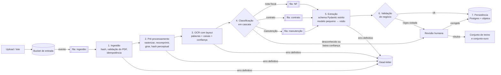

# Desafio 2 — Arquitetura do pipeline de documentos

Proposta de arquitetura para classificar e extrair dados de documentos digitalizados (nota fiscal, contrato de prestação de serviços e relatório de manutenção), dos 50 arquivos do anexo até milhões de documentos. Escopo combinado: **só a arquitetura**, sem implementação.

## 1. O que os 50 arquivos mostram

Tudo abaixo foi verificado nos arquivos do anexo (`pdfinfo`, `pdftotext`, `pdfimages` e leitura visual das páginas).

| Achado | Implicação |
|---|---|
| 50 PDFs distintos (md5 único), **1 página cada**, com uma imagem RGB de 1241×1754 a 150 ppi **sem compressão** (~6,4 MB por arquivo) | Recomprimir na entrada: no formato bruto, 1 milhão de documentos ocupa ~6,4 TB |
| **Nenhuma camada de texto** (`pdftotext` devolve vazio nos 50) | OCR ou modelo de visão é obrigatório |
| **10 layouts** para 3 tipos. Nota fiscal: "FATURA", "NF-e", "DOCUMENTO FISCAL". Contrato: "INSTRUMENTO PARTICULAR DE CONTRATO", "ACORDO DE SERVIÇOS", "Contrato de Serviço", "CONTRATO DE PRESTAÇÃO DE SERVIÇOS". Manutenção: "FICHA DE SERVIÇO", "ORDEM DE SERVIÇO", "Relatório Técnico" | Classificar por palavra-chave falha: "Ordem de Serviço" (manutenção) e "Contrato de Serviço" (contrato) dividem a palavra "Serviço", e nenhum título de nota fiscal diz "nota fiscal" por extenso |
| Rótulos variam para o mesmo campo: Tomador / Contratante / Cliente / Parte A; Total Geral / Montante / Valor a Pagar; Dt. Execução / Realizado em / Data | Extração por template ou por regex de rótulo não generaliza |
| Formatos misturados **dentro do mesmo documento**: "R$ 1992,00", "BRL 4.495,00", "R$4.500,00", "8.000,00"; datas "15/07/24", "15/07/2024", "2023-07-10", "08-11-2024", "14 de setembro de 2023" | O modelo devolve o texto do campo; a normalização (moeda, data) é feita por código determinístico e testado |
| **Total impresso diferente da soma dos itens** em 2 das 3 notas conferidas à mão (`001_rljd`: itens somam R$ 27.334,45 e o total diz R$ 25.791,45; `010_rt7s`: R$ 33.000,00 contra R$ 35.000,00). Na `002_wyfi` a soma bate | Validação de negócio obrigatória. O pipeline **sinaliza** a divergência e guarda os dois valores; nunca "corrige" o documento em silêncio |
| O mesmo documento aparece em duas versões com md5 diferente (`010_rt7s` e `017_cbcq`: mesma fatura, ano com 2 ou 4 dígitos e espaçamento diferente) | Hash do arquivo garante idempotência, mas não acha duplicatas. É preciso também uma chave de negócio (CNPJ + data + total) |
| Nome do arquivo no padrão `NNN_xxxx.pdf` sem relação com o tipo | O nome nunca é usado como sinal |

## 2. Visão geral

Pipeline determinístico em estágios, cada um idempotente, ligado por filas. O LLM entra só onde é necessário (classificação de baixa confiança e extração), e sempre com saída validada por schema.



Cada estágio grava seu resultado com a chave `(hash do arquivo, estágio, versão do estágio)`. Reprocessar um documento só refaz os estágios cuja versão mudou.

## 3. Estágios

### 3.1 Ingestão

- O arquivo chega a um bucket de entrada (S3, GCS ou equivalente) e o evento do bucket entra numa fila.
- `document_id = sha256(bytes)`. Se o hash já foi processado com a mesma versão do pipeline, o evento é descartado (idempotência: a fila pode entregar a mesma mensagem duas vezes).
- Validação do arquivo: é PDF, abre, não está criptografado, tem de 1 a N páginas, tamanho dentro do limite. Falha aqui vai direto para a dead-letter com o motivo.
- Registro em `documents` com origem, hash, status e lote.

### 3.2 Pré-processamento

- Extrai a imagem de cada página (aqui ela já está embutida a 150 ppi) e grava uma cópia recomprimida (WebP ou JPEG de qualidade alta, ordem de grandeza de centenas de KB por página). O original fica em armazenamento frio.
- Corrige rotação e inclinação, e converte para tons de cinza quando melhora o OCR.
- Calcula um **hash perceptual** da página para achar quase-duplicatas visuais.

### 3.3 OCR com layout

- **OCR barato primeiro**: um motor de OCR auto-hospedado em CPU (Tesseract ou PaddleOCR) ou um serviço gerenciado de OCR cobrado por página. A saída tem palavras, caixas delimitadoras e confiança por palavra.
- A saída do OCR é guardada com chave `(hash da imagem, versão do OCR)`: trocar o modelo de extração não refaz o OCR.
- Se a confiança média ficar abaixo do limiar, o documento segue marcado como `ocr_fraco` e os estágios seguintes vão direto ao modelo de visão.

### 3.4 Classificação em cascata (sem palavra-chave)

| Nível | Como | Quando |
|---|---|---|
| 1 | Classificador pequeno sobre o texto do OCR e sinais de layout (embeddings de texto + regressão logística, ou um modelo de layout ajustado) | Todos os documentos. Custo quase zero, milissegundos |
| 2 | LLM pequeno com saída estruturada `{tipo, confiança, justificativa}` e a **definição** de cada tipo, não uma lista de palavras: "formaliza obrigação entre duas partes, com objeto, prazo e preço" = contrato; "registra a venda de itens ou serviços com valores e total" = nota fiscal; "registra uma intervenção num equipamento: defeito, ação, peças" = manutenção | Quando a confiança do nível 1 fica abaixo do limiar calibrado |
| 3 | Modelo de visão sobre a imagem da página | OCR fraco ou nível 2 inseguro |

- Existe a classe **`desconhecido`**: um documento que não é de nenhum dos três tipos vai para revisão, nunca é forçado num tipo.
- No começo não há dados rotulados. O nível 2 rotula uma amostra, pessoas revisam, e esses rótulos treinam o nível 1. Com o tempo, a fração que chega ao LLM cai.

### 3.5 Roteamento

Uma fila por tipo, com workers próprios. Cada tipo tem schema, prompt e versão independentes: mudar o extrator de contratos não toca nas notas fiscais, e cada fila escala conforme o próprio volume.

### 3.6 Extração com schema Pydantic estrito

O modelo recebe o texto do OCR (com as posições) e devolve JSON validado por um schema estrito por tipo. Os campos de dinheiro e data chegam como **texto do documento**; a conversão é feita por código determinístico e testado, porque é aí que o modelo erra em silêncio ("8.000,00" sem moeda, "15/07/24").

```python
from datetime import date
from decimal import Decimal
from typing import Literal

from pydantic import BaseModel, ConfigDict, Field


class Strict(BaseModel):
    model_config = ConfigDict(extra="forbid", str_strip_whitespace=True)


class Evidence(Strict):
    page: int
    text: str  # trecho do OCR de onde o valor saiu
    bbox: tuple[float, float, float, float]  # posição na página, para auditoria e revisão


class Party(Strict):
    name: str
    tax_id: str | None = Field(None, description="CPF ou CNPJ, só dígitos, validado pelo dígito verificador")
    address: str | None = None


class InvoiceItem(Strict):
    description: str
    quantity: Decimal
    unit_price: Decimal
    line_total: Decimal


class Invoice(Strict):  # Nota Fiscal ("Fatura", "NF-e", "Documento Fiscal")
    doc_type: Literal["nota_fiscal"]
    number: str | None
    issue_date: date
    issuer: Party
    items: list[InvoiceItem] = Field(min_length=1)
    printed_total: Decimal  # o total como está impresso


class ServiceContract(Strict):  # "Instrumento Particular", "Acordo de Serviços"...
    doc_type: Literal["contrato_servico"]
    client: Party  # Tomador / Contratante / Cliente / Parte A
    provider: Party  # Fornecedor / Contratada / Prestador / Parte B
    scope: str
    start_date: date
    end_date: date | None
    price: Decimal
    price_period: Literal["mensal", "total", "por_entrega"]
    clauses: list[str] = []


class MaintenanceReport(Strict):  # "Ficha de Serviço", "Ordem de Serviço", "Relatório Técnico"
    doc_type: Literal["relatorio_manutencao"]
    order_number: str | None
    service_date: date
    technician: str
    equipment: str
    asset_tag: str | None
    location: str | None
    problem: str
    action_taken: str
    parts: list[str] = []
    status: Literal["concluido", "aguardando_aprovacao", "pendente"] | None
```

Cada extração é guardada num envelope com a evidência por campo (`Evidence`), a confiança, o modelo, o hash do prompt e a versão do schema.

**Cascata da extração:** modelo pequeno → se o JSON não valida ou a validação de negócio falha, uma nova tentativa com o erro do validador no prompt (o mesmo laço de autocorreção do Desafio 1) → modelo maior ou de visão sobre a imagem → revisão humana.

### 3.7 Validação de negócio

Regras em código, cada uma com um código de motivo:

- nota fiscal: `quantidade × valor unitário = total da linha` e `soma das linhas = total impresso` (falha em 2 das 3 notas conferidas no anexo);
- CPF e CNPJ com dígito verificador válido;
- contrato: `início ≤ término`; preço > 0;
- datas dentro de uma janela plausível;
- duplicata de negócio: mesmo emitente, data e total já persistidos → grava com `duplicate_of`, não descarta.

Uma regra violada não apaga o dado: o documento é persistido com `status = revisar` e o motivo, e entra na fila de revisão.

### 3.8 Persistência

- **Postgres**: `documents` (hash, origem, tipo, confiança, status, versões de cada estágio), uma tabela por tipo (`invoices` + `invoice_items`, `service_contracts`, `maintenance_reports`) e a extração bruta em JSONB com as evidências. Escrita por *upsert* na chave `(document_id, versão do schema)`.
- **Armazenamento de objetos**: original, imagem recomprimida e saída do OCR.
- **Linhagem** em cada linha: versão do OCR, do classificador, do prompt, do schema e o identificador do modelo.

### 3.9 Dead-letter e revisão humana

| Motivo | Exemplo | Saída |
|---|---|---|
| `arquivo_invalido` | PDF corrompido, criptografado, vazio | dead-letter |
| `ocr_ilegivel` | confiança do OCR e do modelo de visão abaixo do limiar | revisão |
| `tipo_desconhecido` | documento fora dos três tipos | revisão |
| `schema_invalido` | JSON não valida depois de toda a cascata | revisão |
| `regra_violada` | total diferente da soma dos itens | revisão (dado persistido) |
| `erro_transitorio_esgotado` | provedor fora do ar além das tentativas | dead-letter, reprocessável |

A dead-letter guarda o motivo e o estágio; um comando reenfileira por motivo depois da correção. As correções feitas na revisão viram rótulos para treinar o classificador e ampliar o conjunto-ouro.

## 4. Escala: milhões de documentos

- **Workers sem estado** por estágio, escalados pela profundidade da fila (Kubernetes com KEDA, ou jobs serverless). OCR em CPU escala de forma horizontal e barata.
- **Ordem de grandeza**: 1 milhão de documentos em 24 h ≈ 12 documentos por segundo no pipeline inteiro.
- **APIs de lote** dos provedores de LLM para tudo o que não é urgente (em geral mais baratas e com mais vazão que a chamada síncrona).
- **Contrapressão e limites**: limitador por provedor e por modelo, retry com backoff exponencial, circuit breaker e fallback de modelo, como no Desafio 1.
- **Armazenamento**: recomprimir na entrada reduz em uma ou duas ordens de grandeza o volume dos ~6,4 TB brutos por milhão.

## 5. Custo

O custo por documento é a soma da cascata, ponderada pela fração que chega a cada nível:

```
custo ≈ OCR + classif_pequeno + p₂·classif_LLM + extração_pequeno + p₃·extração_visão + p_rev·revisão_humana
```

- O OCR auto-hospedado custa só CPU. O texto de uma página destas fica na casa de centenas de tokens, o que deixa barata a extração com modelo pequeno.
- A visão e o modelo grande são os itens caros, então ficam como fallback (`p₃` pequeno). A revisão humana é o item mais caro de todos, e por isso cada motivo de revisão é medido.
- Cache por hash: reenviar o mesmo arquivo custa zero, e uma mudança de prompt refaz só a extração.
- Métrica de gestão: **custo por documento aceito** e a fração de cada nível, por tipo e por lote.

## 6. Reprodutibilidade e qualidade

- Cada resultado guarda as versões que o produziram. Um reprocessamento com as mesmas versões dá o mesmo resultado, porque a saída do LLM fica em cache pela chave `(entrada, modelo, prompt, schema)`. Isso importa porque alguns modelos ignoram `temperature` (observado no Desafio 1).
- **Conjunto-ouro**: os 50 documentos do anexo rotulados à mão (tipo + campos). Toda mudança de prompt, schema ou modelo roda contra ele no CI, medindo a acurácia da classificação e o acerto exato por campo depois da normalização. É o mesmo método de avaliação do Desafio 1, aplicado a documentos.
- Em produção: amostragem contínua de documentos aceitos para revisão humana, para medir a deriva da qualidade.

## 7. Observabilidade

- Trace por documento: estágios, latência, modelo, tokens, confiança e motivo de cada desvio.
- Painel: vazão, profundidade das filas, taxa de dead-letter e de revisão por motivo, custo por documento, distribuição da confiança por tipo.

## 8. Segurança e LGPD

Contratos e notas trazem nome, CPF, CNPJ e endereço.

- Criptografia em repouso e em trânsito, acesso por papel, trilha de auditoria de quem viu cada documento na revisão.
- Provedor de LLM com contrato que proíbe uso dos dados para treino, ou modelo auto-hospedado para os documentos mais sensíveis.
- Pseudonimizar CPF e nomes antes do LLM quando o campo não precisa ser extraído (a mesma técnica do Desafio 1), e retenção mínima das imagens originais.

## 9. Alternativas descartadas

| Alternativa | Por que não |
|---|---|
| Classificar por palavra-chave ou regex no título | Já falha no anexo: 10 layouts, títulos sem o nome do tipo, "Serviço" em dois tipos diferentes |
| Extração por template (zonas fixas por layout) | Cada layout novo exige um template; 10 layouts em só 50 arquivos |
| Modelo de visão grande para todos os documentos | Melhor qualidade bruta, mas o mais caro e lento; fica como fallback |
| Só OCR + regex para os campos | Quebra com a variação de rótulos e de formatos |
| Ajustar (fine-tuning) um modelo grande desde o início | Não há dados rotulados; começar com zero-shot e usar a revisão humana para gerar rótulos |
| Agente com várias ferramentas por documento | Os estágios são fixos e conhecidos; um pipeline determinístico é mais barato, testável e auditável. O LLM entra só onde há ambiguidade |

## 10. Plano incremental

1. Rotular os 50 documentos (conjunto-ouro) e implementar OCR → classificação nível 2 → extração com schema → validação, medindo contra o ouro.
2. Persistência, idempotência, dead-letter e a fila de revisão.
3. Classificador nível 1 treinado com os rótulos acumulados; modelo de visão como fallback.
4. Filas por tipo, autoscaling, APIs de lote e painel de custo.
