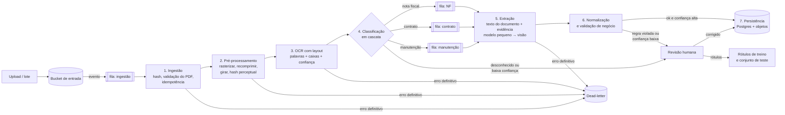

# Desafio 2 — Arquitetura do pipeline de documentos

Proposta de arquitetura para classificar e extrair dados de documentos digitalizados (nota fiscal, contrato de prestação de serviços e relatório de manutenção), dos 50 arquivos do anexo até milhões de documentos. Escopo combinado: **só a arquitetura**, sem implementação.

## 1. O que os 50 arquivos mostram

Tudo abaixo foi verificado nos arquivos do anexo (`pdfinfo`, `pdftotext`, `pdfimages` e leitura visual das páginas).

| Achado | Implicação |
|---|---|
| 50 PDFs distintos (md5 único), **1 página cada**, com uma imagem RGB de 1241×1754 a 150 ppi **sem compressão** (~6,4 MB por arquivo) | Recomprimir na entrada: no formato bruto, 1 milhão de documentos ocupa ~6,4 TB |
| **Nenhuma camada de texto** (`pdftotext` devolve vazio nos 50) | OCR ou modelo de visão é obrigatório |
| **10 layouts** para 3 tipos. Nota fiscal: "FATURA", "NF-e", "DOCUMENTO FISCAL". Contrato: "INSTRUMENTO PARTICULAR DE CONTRATO", "ACORDO DE SERVIÇOS", "Contrato de Serviço", "CONTRATO DE PRESTAÇÃO DE SERVIÇOS". Manutenção: "FICHA DE SERVIÇO", "ORDEM DE SERVIÇO", "Relatório Técnico" | Classificar por palavra-chave falha: "Ordem de Serviço" (manutenção) e "Contrato de Serviço" (contrato) dividem a palavra "Serviço", e nenhum título de nota fiscal diz "nota fiscal" por extenso |
| Rótulos variam para o mesmo campo: Tomador / Contratante / Cliente / Parte A; Total Geral / Montante / Valor a Pagar; Dt. Execução / Realizado em / Data | Extração por template ou por regex de rótulo não generaliza |
| Formatos misturados **dentro do mesmo documento**: "R$ 1992,00", "BRL 4.495,00", "R$4.500,00", "8.000,00"; datas "15/07/24", "15/07/2024", "2023-07-10", "08-11-2024", "14 de setembro de 2023" | O modelo devolve o texto do campo; a normalização (moeda, data) é feita por código determinístico e testado |
| **Total impresso diferente da soma dos itens** em 2 das 3 notas conferidas à mão (`001_rljd`: itens somam R$ 27.334,45 e o total diz R$ 25.791,45; `010_rt7s`: R$ 33.000,00 contra R$ 35.000,00). Na `002_wyfi` a soma bate | Validação de negócio obrigatória. O pipeline **sinaliza** a divergência e guarda os dois valores; nunca "corrige" o documento em silêncio |
| O mesmo documento aparece em duas versões com md5 diferente (`010_rt7s` e `017_cbcq`: mesma fatura, ano com 2 ou 4 dígitos e espaçamento diferente) | Hash do arquivo garante idempotência, mas não acha duplicatas. É preciso também uma chave de negócio (CNPJ + data + total) |
| Nome do arquivo no padrão `NNN_xxxx.pdf` sem relação com o tipo | O nome nunca é usado como sinal |

## 2. Visão geral

Pipeline determinístico em estágios, cada um idempotente, ligado por filas. O LLM entra só onde é necessário (classificação de baixa confiança e extração), e sempre com saída validada por schema.

**Entrada.** O enunciado pede um script que processe todos os arquivos da pasta `data/raw/`. Esse é o modo lote: um comando lista a pasta e publica um evento por arquivo na mesma fila de ingestão. Em produção, o bucket de entrada ocupa o lugar da pasta, e os estágios seguintes não mudam.

**Stack.** Python, com LangChain na chamada ao LLM: saída estruturada direto no schema Pydantic (`with_structured_output`) e troca de provedor ou de modelo sem mudar o código dos estágios. O LangGraph não entra no fluxo principal, porque os estágios são fixos e um pipeline com filas é mais barato de testar e operar (ver a seção 10). Ele cabe no ramo de revisão humana, onde o processamento precisa pausar, guardar o estado e retomar depois da correção.



Cada estágio grava seu resultado com a chave `(hash do arquivo, estágio, versão do estágio)`. Reprocessar um documento só refaz os estágios cuja versão mudou.

## 3. Estágios

### 3.1 Ingestão

- O arquivo chega a um bucket de entrada (S3, GCS ou equivalente) e o evento do bucket entra numa fila.
- `document_id = sha256(bytes)`. Se o hash já foi processado com a mesma versão do pipeline, o evento é descartado (idempotência: a fila pode entregar a mesma mensagem duas vezes).
- Validação do arquivo: é PDF, abre, não está criptografado, tem de 1 a N páginas, tamanho dentro do limite. Falha aqui vai direto para a dead-letter com o motivo.
- Registro em `documents` com origem, hash, status e lote.

### 3.2 Pré-processamento

- Extrai a imagem de cada página (aqui ela já está embutida a 150 ppi) e grava uma cópia recomprimida (WebP ou JPEG de qualidade alta, ordem de grandeza de centenas de KB por página). O original fica em armazenamento frio.
- Corrige rotação e inclinação, e converte para tons de cinza quando melhora o OCR.
- Calcula um **hash perceptual** da página para achar quase-duplicatas visuais.

### 3.3 OCR com layout

- **OCR barato primeiro**: um motor de OCR auto-hospedado em CPU (Tesseract ou PaddleOCR) ou um serviço gerenciado de OCR cobrado por página. A saída tem palavras, caixas delimitadoras e confiança por palavra.
- A saída do OCR é guardada com chave `(hash da imagem, versão do OCR)`: trocar o modelo de extração não refaz o OCR.
- Se a confiança média ficar abaixo do limiar, o documento segue marcado como `ocr_fraco` e os estágios seguintes vão direto ao modelo de visão.

### 3.4 Classificação em cascata (sem palavra-chave)

| Nível | Como | Quando |
|---|---|---|
| 1 | Classificador pequeno sobre o texto do OCR e sinais de layout (embeddings de texto + regressão logística, ou um modelo de layout ajustado) | Todos os documentos. Custo quase zero, milissegundos |
| 2 | LLM pequeno com saída estruturada `{tipo, confiança, justificativa}` e a **definição** de cada tipo, não uma lista de palavras: "formaliza obrigação entre duas partes, com objeto, prazo e preço" = contrato; "registra a venda de itens ou serviços com valores e total" = nota fiscal; "registra uma intervenção num equipamento: defeito, ação, peças" = manutenção | Quando a confiança do nível 1 fica abaixo do limiar calibrado |
| 3 | Modelo de visão sobre a imagem da página | OCR fraco ou nível 2 inseguro |

- Existe a classe **`desconhecido`**: um documento que não é de nenhum dos três tipos vai para revisão, nunca é forçado num tipo.
- No começo não há dados rotulados. O nível 2 rotula uma amostra, pessoas revisam, e esses rótulos treinam o nível 1. Com o tempo, a fração que chega ao LLM cai.
- A `confiança` que o LLM declara não é usada como probabilidade (modelos são mal calibrados ao falar da própria certeza). O limiar do nível 1 e o roteamento seguem a seção 3.8.

### 3.5 Roteamento

Uma fila por tipo, com workers próprios. Cada tipo tem schema, prompt e versão independentes: mudar o extrator de contratos não toca nas notas fiscais, e cada fila escala conforme o próprio volume.

### 3.6 Extração: o LLM copia, o código converte

São dois schemas por tipo. O **schema de extração** é o que o LLM preenche: cada campo traz o texto exatamente como está no documento e a evidência de onde saiu. O **modelo normalizado** é o que vai ao banco, com `Decimal` e `date`, e só o código o produz, porque é na conversão que o modelo erra em silêncio ("8.000,00" sem moeda, "15/07/24", "14 de setembro de 2023").

```python
from datetime import date
from decimal import Decimal
from typing import Literal

from pydantic import BaseModel, ConfigDict, Field


class Strict(BaseModel):
    model_config = ConfigDict(extra="forbid", str_strip_whitespace=True)


class Evidence(Strict):
    page: int
    bbox: tuple[float, float, float, float]  # posição na página, para auditoria e revisão


class Raw(Strict):
    """Um campo como o LLM o devolve: o texto do documento, nunca um valor convertido."""

    text: str | None  # "R$ 1992,00", "15/07/24", "Tomador: ACME LTDA"; None se o campo não existe
    evidence: Evidence | None


# --- schema de extração (saída do LLM, validada com with_structured_output) ---


class InvoiceItemRaw(Strict):
    description: Raw
    quantity: Raw
    unit_price: Raw
    line_total: Raw


class InvoiceRaw(Strict):  # Nota Fiscal ("Fatura", "NF-e", "Documento Fiscal")
    doc_type: Literal["nota_fiscal"]
    number: Raw
    access_key: Raw  # chave de acesso de 44 dígitos, quando o documento é um DANFE de NF-e
    issue_date: Raw
    issuer_name: Raw
    issuer_tax_id: Raw
    items: list[InvoiceItemRaw] = Field(min_length=1)
    printed_total: Raw


# ServiceContractRaw e MaintenanceReportRaw seguem o mesmo padrão: um Raw por campo.


# --- modelo normalizado (saída do código; é o que vai ao Postgres) ---


class Party(Strict):
    name: str
    tax_id: str | None = Field(None, description="CPF ou CNPJ, só dígitos, com dígito verificador válido")
    address: str | None = None


class InvoiceItem(Strict):
    description: str
    quantity: Decimal
    unit_price: Decimal
    line_total: Decimal


class Invoice(Strict):
    doc_type: Literal["nota_fiscal"]
    number: str | None
    access_key: str | None  # 44 dígitos, DV conferido (seção 3.7)
    issue_date: date
    issuer: Party
    items: list[InvoiceItem] = Field(min_length=1)
    printed_total: Decimal  # o total como está impresso, mesmo que difira da soma dos itens


class ServiceContract(Strict):  # "Instrumento Particular", "Acordo de Serviços"...
    doc_type: Literal["contrato_servico"]
    client: Party  # Tomador / Contratante / Cliente / Parte A
    provider: Party  # Fornecedor / Contratada / Prestador / Parte B
    scope: str
    start_date: date
    end_date: date | None
    price: Decimal
    price_period: Literal["mensal", "total", "por_entrega"]
    clauses: list[str] = []


class MaintenanceReport(Strict):  # "Ficha de Serviço", "Ordem de Serviço", "Relatório Técnico"
    doc_type: Literal["relatorio_manutencao"]
    order_number: str | None
    service_date: date
    technician: str
    equipment: str
    asset_tag: str | None
    location: str | None
    problem: str
    action_taken: str
    parts: list[str] = []
    status: Literal["concluido", "aguardando_aprovacao", "pendente"] | None
```

A normalização é uma função por campo (`parse_money("BRL 4.495,00") → Decimal("4495.00")`, `parse_date("15/07/24") → date(2024, 7, 15)`), com testes de tabela montados a partir dos formatos vistos no anexo. Uma data ambígua ("08-11-2024" pode ser 8 de novembro ou 11 de agosto) não é adivinhada: o campo fica com confiança baixa e vai para revisão. O envelope de cada extração guarda o `Raw` original, o valor normalizado, a confiança (seção 3.8), o modelo, o hash do prompt e a versão do schema.

**Cascata da extração:** modelo pequeno → se o JSON não valida, a normalização falha ou a validação de negócio falha, uma nova tentativa com o erro no prompt (o mesmo laço de autocorreção do Desafio 1) → modelo de visão sobre a imagem → revisão humana.

### 3.7 Validação de negócio

Regras em código, cada uma com um código de motivo:

- nota fiscal: `quantidade × valor unitário = total da linha` e `soma das linhas = total impresso` (falha em 2 das 3 notas conferidas no anexo);
- CPF e CNPJ com dígito verificador válido;
- chave de acesso da NF-e, quando existir (abaixo);
- contrato: `início ≤ término`; preço > 0;
- datas dentro de uma janela plausível;
- duplicata de negócio: mesmo emitente, data e total já persistidos → grava com `duplicate_of`, não descarta.

Uma regra violada não apaga o dado: o documento é persistido com `status = revisar` e o motivo. Se os valores em conflito têm evidência e confiança alta (o OCR leu bem os dois números), o problema é do documento, não da extração: ele vai para a fila de **exceções de negócio**, não para a revisão de extração. Isso importa porque, no anexo, a divergência de total é a regra, não a exceção.

**NF-e: chave de acesso e SEFAZ.** Num DANFE, a chave de 44 dígitos permite conferir o documento sem confiar no OCR:

1. **Estrutura**: `cUF (2) · AAMM da emissão (4) · CNPJ do emitente (14) · modelo (2) · série (3) · número (9) · tipo de emissão (1) · código numérico (8) · DV (1)`.
2. **Dígito verificador (módulo 11)**: multiplicar os 43 primeiros dígitos, da direita para a esquerda, pelos pesos 2, 3, …, 9, recomeçando em 2; `DV = 11 − (soma mod 11)`, e vale 0 quando o resultado é 10 ou 11. Um único dígito lido errado pelo OCR quebra o DV, então a regra pega erro de leitura de graça.
3. **Coerência com os campos extraídos**: modelo `55` (NF-e) ou `65` (NFC-e), `cUF` na tabela do IBGE, `AAMM` igual ao mês da `issue_date`, CNPJ da chave igual ao `issuer_tax_id` e número igual ao `number`. Divergência vira `regra_violada` com o campo apontado.
4. **Consulta à SEFAZ** (`NFeConsultaProtocolo`): confirma se a nota foi autorizada (`cStat 100`), cancelada (`101`), denegada (`110`) ou não existe (`217`). O web service exige certificado digital ICP-Brasil (A1) da empresa e tem limite de consultas, então a consulta é assíncrona, com fila e limitador próprios, e o resultado fica em cache pela chave. A consulta pública do portal tem captcha e não serve para automação.
5. **XML como fonte da verdade**: quando a empresa é destinatária da nota, o XML autorizado pode ser baixado pela Distribuição DF-e. Nesse caso os campos do XML substituem os do OCR, e a extração serve só para casar o PDF com o XML.

"FATURA" e "DOCUMENTO FISCAL" não necessariamente são NF-e. Sem chave, a nota segue só com as regras de soma e de CNPJ.

### 3.8 Confiança por campo e limiares

A confiança de um campo combina sinais medidos, não a opinião do modelo sobre si mesmo:

| Sinal | Como se obtém |
|---|---|
| Evidência confere | O `Raw.text` precisa aparecer no texto do OCR dentro da `bbox` declarada (comparação depois de normalizar espaços e caixa). Se não aparece, o modelo inventou ou trocou o campo: confiança zero |
| Qualidade da leitura | Menor confiança do OCR entre as palavras da `bbox` |
| Normalização | O parser aceitou o texto sem ambiguidade (uma data "08-11-2024" não passa) |
| Regras de negócio | DV de CNPJ/CPF/chave, soma das linhas, coerência da chave com os campos |
| Concordância | Para campos críticos (total, CNPJ, data, chave) com sinais fracos: uma segunda extração (modelo de visão) e comparação dos valores normalizados |
| Probabilidade do token | Quando o provedor expõe *logprobs*, a menor probabilidade entre os tokens do valor |

**Calibração.** Os sinais entram numa regressão logística por tipo de campo, treinada com o veredito da revisão humana (o campo estava certo ou não). A saída é calibrada (isotônica, no conjunto de validação) para que "0,95" signifique 95% de acerto observado, conferido por diagrama de confiabilidade a cada versão. O limiar de aceite automático é escolhido por campo, como o menor valor em que a precisão dos aceitos fica na meta da seção 7 (99,5% nos campos críticos). Sobe o limiar, sobe o `p_rev`: a troca entre custo e erro fica explícita.

**Antes de haver rótulos**, vale uma regra conservadora: aceita sozinho só o campo com evidência conferida, OCR acima de 0,9, normalização sem ambiguidade e regras aprovadas. O resto vai para revisão. A calibração começa com algumas centenas de campos revisados por tipo.

### 3.9 Persistência

- **Postgres**: `documents` (hash, origem, tipo, confiança, status, versões de cada estágio), uma tabela por tipo (`invoices` + `invoice_items`, `service_contracts`, `maintenance_reports`) e a extração bruta em JSONB com as evidências. Escrita por *upsert* na chave `(document_id, versão do schema)`.
- **Armazenamento de objetos**: original, imagem recomprimida e saída do OCR.
- **Linhagem** em cada linha: versão do OCR, do classificador, do prompt, do schema e o identificador do modelo.

### 3.10 Dead-letter e revisão humana

| Motivo | Exemplo | Saída |
|---|---|---|
| `arquivo_invalido` | PDF corrompido, criptografado, vazio | dead-letter |
| `ocr_ilegivel` | confiança do OCR e do modelo de visão abaixo do limiar | revisão |
| `tipo_desconhecido` | documento fora dos três tipos | revisão |
| `schema_invalido` | JSON não valida depois de toda a cascata | revisão |
| `confianca_baixa` | campo abaixo do limiar calibrado | revisão (só os campos fracos) |
| `regra_violada` | total diferente da soma dos itens, com leitura confiável | exceção de negócio (dado persistido) |
| `nfe_nao_autorizada` | SEFAZ responde cancelada, denegada ou inexistente | exceção de negócio |
| `erro_transitorio_esgotado` | provedor fora do ar além das tentativas | dead-letter, reprocessável |

A dead-letter guarda o motivo e o estágio; um comando reenfileira por motivo depois da correção. As correções feitas na revisão viram rótulos para treinar o classificador e calibrar a confiança.

## 4. Escala: milhões de documentos

- **Workers sem estado** por estágio, escalados pela profundidade da fila (Kubernetes com KEDA, ou jobs serverless). OCR em CPU escala de forma horizontal e barata.
- **Ordem de grandeza**: 1 milhão de documentos em 24 h ≈ 12 documentos por segundo no pipeline inteiro.
- **APIs de lote** dos provedores de LLM para tudo o que não é urgente (em geral mais baratas e com mais vazão que a chamada síncrona).
- **Contrapressão e limites**: limitador por provedor e por modelo, retry com backoff exponencial, circuit breaker e fallback de modelo, como no Desafio 1.
- **Armazenamento**: recomprimir na entrada reduz em uma ou duas ordens de grandeza o volume dos ~6,4 TB brutos por milhão.

## 5. Custo

O custo por documento é a soma da cascata, ponderada pela fração que chega a cada nível:

```
custo ≈ OCR + classif_pequeno + p₂·classif_LLM + extração·(1 + p_retry) + p₃·extração_visão + p_rev·revisão_humana
```

**Premissas** (estimativas para dimensionar, a conferir num piloto):

| Item | Premissa | Custo unitário |
|---|---|---|
| LLM | `gemini-3.5-flash-lite`, US$ 0,30 por milhão de tokens de entrada e US$ 2,50 de saída (preço público do tier pago em 13/11/2026, o mesmo do Desafio 1) | — |
| OCR auto-hospedado | ~2 s de vCPU por página, a ~US$ 0,04 por vCPU-hora | US$ 0,00002 |
| Classificação nível 1 | embeddings + regressão logística em CPU | ~0 |
| Classificação nível 2 (LLM) | ~1.200 tokens de entrada (texto + definições), ~60 de saída | US$ 0,0005 |
| Extração (texto com posições) | ~2.500 tokens de entrada, ~500 de saída (JSON com evidências) | US$ 0,0020 |
| Extração por visão | o mesmo modelo, que aceita imagem: ~1.500 tokens da página + ~1.000 de prompt, ~500 de saída | US$ 0,0020 |
| Revisão humana | ~2 min por documento, a R$ 40 por hora com encargos, R$ 5,50 por US$ | US$ 0,24 (R$ 1,33) |

Com essas premissas:

| Cenário | p₂ | p_retry | p₃ | p_rev | Automático por documento | Total por documento | Por milhão | Parte humana | Horas de revisão por milhão |
|---|---|---|---|---|---|---|---|---|---|
| Início (sem nível 1 treinado, limiares conservadores) | 100% | 15% | 15% | 20% | US$ 0,0031 | US$ 0,052 | ~US$ 52 mil | 94% | ~6.700 |
| Regime (nível 1 treinado, confiança calibrada) | 20% | 10% | 5% | 3% | US$ 0,0024 | US$ 0,0097 | ~US$ 9,7 mil | 75% | ~1.000 |

O que a conta mostra:

- **A revisão humana domina o custo** nos dois cenários. Trocar de modelo mexe em centavos por mil documentos; baixar `p_rev` de 20% para 3% corta o custo total em cinco vezes. Por isso o esforço vai para a calibração da seção 3.8 e para separar exceção de negócio (o documento está errado) de revisão de extração (o pipeline leu mal).
- A parte automática fica em torno de US$ 2.400 a 3.100 por milhão. Com a API de lote (o Gemini Batch cobra cerca de metade do preço síncrono; conferir na tabela vigente), cai para perto da metade nos documentos sem urgência.
- Armazenamento por milhão: ~300 GB de imagens recomprimidas em armazenamento padrão (ordem de US$ 7 por mês) e os ~6,4 TB originais em camada fria ou de arquivo (ordem de US$ 6 a 25 por mês, conforme a camada). Pequeno perto da revisão.
- Cache por hash: reenviar o mesmo arquivo custa zero, e uma mudança de prompt refaz só a extração.
- Métrica de gestão: **custo por documento aceito**, com `p₂`, `p_retry`, `p₃` e `p_rev` medidos por tipo, por layout e por lote. As premissas da tabela são trocadas pelos valores medidos no piloto.

## 6. Reprodutibilidade e qualidade

- Cada resultado guarda as versões que o produziram. Um reprocessamento com as mesmas versões dá o mesmo resultado, porque a saída do LLM fica em cache pela chave `(entrada, modelo, prompt, schema)`. Isso importa porque alguns modelos ignoram `temperature` (observado no Desafio 1).
- **Conjunto de referência**: os 50 documentos do anexo rotulados à mão (tipo + campos normalizados + bbox de cada campo). Toda mudança de prompt, schema ou modelo roda contra ele no CI, medindo a acurácia da classificação e o acerto exato por campo depois da normalização. É o mesmo método de avaliação do Desafio 1, aplicado a documentos.
- **Split por layout.** Com 50 documentos em 10 layouts, ajustar o prompt e medir no mesmo conjunto mede a memória do prompt, não a generalização. A divisão é por grupo:
  - **ajuste**: 7 layouts, usados para escrever prompt, definições e regras de normalização;
  - **teste congelado**: 3 layouts inteiros, um de cada tipo, que ninguém olha durante o ajuste. O arquivo é travado por hash, como o conjunto congelado do Desafio 1. Ele mede o caso que importa em produção: um layout que o pipeline nunca viu;
  - versões do mesmo documento (`010_rt7s` e `017_cbcq`) ficam sempre no mesmo lado, agrupadas pela chave de negócio;
  - durante o ajuste, validação cruzada deixando um layout de fora (*leave-one-layout-out*) mostra quais layouts dependem de ajuste específico.
- Com tão poucos documentos, o relatório traz o intervalo de Wilson e o resultado por layout. Um acerto de 15 em 15 no teste congelado ainda tem limite inferior de ~80%, e o documento diz isso.
- **Em produção**: uma amostra mensal estratificada por tipo e layout dos documentos aceitos automaticamente passa por revisão dupla. Ela mede a deriva, recalibra a confiança e vira o novo conjunto de teste. Esse conjunto nunca é usado para ajustar o prompt.

## 7. Operação: metas, SLA e tela de revisão

**Metas** (proposta inicial, a fechar com a área de negócio):

| Indicador | Meta | Onde se mede |
|---|---|---|
| Acurácia da classificação | ≥ 99% | teste congelado e amostra mensal |
| Precisão dos campos críticos aceitos sem revisão (total, CNPJ/CPF, data, chave da NF-e) | ≥ 99,5% | amostra mensal com revisão dupla |
| Precisão dos demais campos aceitos | ≥ 97% | amostra mensal |
| Documentos aceitos sem revisão humana (cobertura) | ≥ 85% em regime | painel |
| `p_rev` (revisão de extração, sem exceções de negócio) | ≤ 5% em regime | painel |
| Latência do upload à persistência, sem revisão | p95 ≤ 5 min no modo contínuo; lote de 1 milhão em 24 h | traces |

**SLA da revisão humana:**

- documentos marcados como urgentes (pagamento a liberar, contrato a assinar): 4 horas úteis;
- demais: 1 dia útil;
- exceções de negócio: 2 dias úteis, com a área dona do processo, não com o time de revisão.

A fila é ordenada por prazo e por valor do documento. A capacidade sai da conta da seção 5: com `p_rev` de 3% e 2 minutos por documento, 1 milhão de documentos pede ~1.000 horas de revisão, ou cerca de 6 pessoas em tempo integral ao longo de um mês. Se o volume chegar de uma vez, o SLA só se mantém com mais revisores ou com o `p_rev` mais baixo, e o painel mostra a fila projetada contra a capacidade.

**Tela de revisão:**

```
┌──────────────────────────────────────────┬───────────────────────────────────────────┐
│  imagem da página                        │  Nota fiscal · 001_rljd · prazo 3h12      │
│                                          │  ⚠ soma dos itens R$ 27.334,45            │
│   ┌──────────────┐                       │    ≠ total impresso R$ 25.791,45          │
│   │ Total Geral  │ ← caixa do campo      │                                           │
│   │ R$ 25.791,45 │   selecionado         │  Campos com confiança baixa (abertos)     │
│   └──────────────┘                       │   Data de emissão  "08-11-2024"  0,41     │
│                                          │     → [ 08/11/2024 ▾ ]  ambígua           │
│                                          │   CNPJ emitente  "12.345.678/0001-9O"     │
│                                          │     → DV inválido, corrigir: [_______]    │
│                                          │                                           │
│                                          │  Campos aceitos (fechados) ▸ 11           │
│                                          │                                           │
│  zoom · girar · próxima página           │  [Aceitar ⏎] [Reclassificar] [Ilegível]   │
│                                          │  [Duplicata de…] [Exceção de negócio]     │
└──────────────────────────────────────────┴───────────────────────────────────────────┘
```

- Só os campos abaixo do limiar vêm abertos. Os aceitos ficam recolhidos e podem ser conferidos.
- Clicar num campo destaca a `bbox` na imagem; o texto original (`Raw.text`) aparece ao lado do valor normalizado.
- Tudo funciona pelo teclado (Tab entre campos, Enter aceita), porque o tempo por documento é o maior custo do sistema.
- Cada ação grava quem, quando, o valor antes e depois e o motivo. Esses registros são os rótulos da calibração e do treino do nível 1.
- 5% das revisões são refeitas por outra pessoa, às cegas, para medir a concordância entre revisores. Sem isso, a meta de 99,5% não tem como ser medida.

## 8. Observabilidade

- Trace por documento: estágios, latência, modelo, tokens, confiança e motivo de cada desvio.
- Painel: vazão, profundidade das filas, taxa de dead-letter e de revisão por motivo, custo por documento, distribuição da confiança por tipo, fila de revisão projetada contra a capacidade e os indicadores da seção 7.

## 9. Segurança e LGPD

Contratos e notas trazem nome, CPF, CNPJ e endereço; relatórios de manutenção trazem o nome do técnico e, às vezes, do cliente.

**Controles técnicos:**

- Criptografia em repouso e em trânsito, acesso por papel, trilha de auditoria de quem viu cada documento na revisão.
- Provedor de LLM com contrato que proíbe uso dos dados para treino e com retenção zero ou mínima dos prompts, ou modelo auto-hospedado para os documentos mais sensíveis.
- Pseudonimizar CPF e nomes antes do LLM quando o campo não precisa ser extraído (a mesma técnica do Desafio 1). Na extração por visão a imagem vai inteira, então esse caminho entra no RIPD.

**Base legal e papéis** (a validar com o jurídico e o encarregado de dados):

- Quem define a finalidade é o controlador; o pipeline, rodando para um cliente, atua como operador (art. 5º, VI e VII, e art. 39 da LGPD), com contrato que delimita finalidade, prazos e subcontratados (o provedor do LLM é suboperador).
- Bases legais prováveis: execução de contrato (art. 7º, V) para contratos e ordens de serviço, e cumprimento de obrigação legal ou regulatória (art. 7º, II) para documentos fiscais. Usos secundários, como treinar o classificador com documentos reais, precisam de base própria (legítimo interesse, art. 7º, IX, com teste de balanceamento) ou de dados anonimizados.
- **Transferência internacional**: se o provedor processa fora do Brasil, a transferência segue o art. 33 e a Resolução CD/ANPD nº 19/2024 (cláusulas-padrão contratuais). Um modelo servido em região no Brasil (conferir a disponibilidade no Vertex AI) evita a questão para o processamento do modelo.
- **RIPD** (art. 38): recomendado antes de entrar em produção, pelo volume, pela automação de decisões com efeito financeiro e pelo envio de documentos a um terceiro. Ele registra os dados tratados, os fluxos (inclusive o de visão), os riscos e os controles acima.

**Retenção:**

| Artefato | Prazo proposto |
|---|---|
| Documento fiscal (original, imagem, OCR, extração) | 5 anos a partir do primeiro dia do exercício seguinte, prazo decadencial tributário (CTN, art. 173), salvo prazo maior do cliente |
| Contrato e relatório de manutenção | vigência do contrato mais o prazo prescricional aplicável, definido com o jurídico |
| Original não comprimido | só até a imagem recomprimida ser validada, se o cliente não exigir o original |
| Cache do LLM e saída do OCR | o mesmo prazo do documento de origem (contêm os mesmos dados) |
| Traces e logs | 90 dias, sem conteúdo de campo, só ids e métricas |
| Backups | expiram pela rotação (ex.: 35 dias); uma eliminação vale para eles quando a rotação passar, e isso é informado ao titular |

**Direito de eliminação (art. 18, VI) que alcança tudo.** Cada documento tem um `document_id`, e todo artefato derivado é indexado por ele: imagem, OCR, entradas do cache do LLM (a chave inclui o hash da entrada), extrações, rótulos de revisão, conjunto de teste e exemplos de treino. Um índice `titular → document_ids`, montado a partir dos CPFs e nomes extraídos, responde a pedidos de acesso e de eliminação. A eliminação apaga todos os artefatos do `document_id`, remove o documento do conjunto de teste (o relatório seguinte registra a mudança de n) e marca o classificador do nível 1 para retreino sem ele. Quando há obrigação legal de guarda (art. 16, I), como num documento fiscal ainda no prazo, o dado não é apagado: fica bloqueado para qualquer uso além da guarda, e o titular é informado. No conjunto de referência, o padrão é usar documentos sintéticos como os do anexo; documentos reais entram só pseudonimizados nos rótulos e com o mesmo prazo de retenção.

## 10. Alternativas descartadas

| Alternativa | Por que não |
|---|---|
| Classificar por palavra-chave ou regex no título | Já falha no anexo: 10 layouts, títulos sem o nome do tipo, "Serviço" em dois tipos diferentes |
| Extração por template (zonas fixas por layout) | Cada layout novo exige um template; 10 layouts em só 50 arquivos |
| Modelo de visão grande para todos os documentos | Melhor qualidade bruta, mas o mais caro e lento; fica como fallback |
| Só OCR + regex para os campos | Quebra com a variação de rótulos e de formatos |
| LLM devolvendo `Decimal` e `date` direto | O modelo converte "15/07/24" e "8.000,00" sem avisar quando erra; o texto original com evidência deixa a conversão testável e auditável |
| Confiança declarada pelo próprio LLM | Mal calibrada; os sinais da seção 3.8 são medidos |
| Ajustar (fine-tuning) um modelo grande desde o início | Não há dados rotulados; começar com zero-shot e usar a revisão humana para gerar rótulos |
| Agente com várias ferramentas por documento | Os estágios são fixos e conhecidos; um pipeline determinístico é mais barato, testável e auditável. O LLM entra só onde há ambiguidade |

## 11. Plano incremental

1. Rotular os 50 documentos de `data/raw/`, separar o teste congelado por layout e implementar OCR → classificação nível 2 → extração com schema → normalização → validação (inclusive a chave da NF-e), medindo contra o conjunto de ajuste.
2. Persistência, idempotência, dead-letter, a tela e a fila de revisão. Piloto com volume real para trocar as premissas de custo pelos valores medidos.
3. Calibração da confiança com os rótulos da revisão, classificador nível 1 treinado, modelo de visão como fallback e consulta à SEFAZ.
4. Filas por tipo, autoscaling, APIs de lote, painel de custo e de SLA, RIPD e rotinas de retenção e eliminação.
